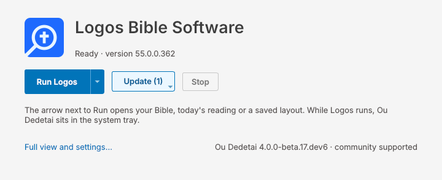

[]()
[](https://app.codacy.com/manual/FaithLife-Community/OuDedetai?utm_source=github.com&utm_medium=referral&utm_content=FaithLife-Community/OuDedetai&utm_campaign=Badge_Grade_Dashboard)
[](https://github.com/FaithLife-Community/LogosLinuxInstallTests) [](https://www.logos.com) [](https://github.com/FaithLife-Community/OuDedetai/releases)

# Ou Dedetai

> **You're on the `next` branch:** a preview of the next version for testing and review. See
> [NEXT.md](NEXT.md) for what's new, why, the latest test build and the release plan.

>Remember Jesus Christ, risen from the dead, the offspring of David, as preached in my gospel, for which I am suffering, bound with chains as a criminal. But **the word** of God **is not bound!**
>
>ἀλλʼ **ὁ λόγος** τοῦ θεοῦ **οὐ δέδεται**  

—Second Timothy 2:8–9 [ESV](https://biblia.com/bible/esv/2-timothy/2/8-9), [NA<sup>28</sup>](https://biblia.com/bible/ubs5/2-timothy/2/9)

## Logos Bible Software on Linux

Ou Dedetai installs [FaithLife](https://faithlife.com/)'s [Logos Bible Software](https://www.logos.com/)
(or Verbum) on Linux, keeps it running well under [Wine](https://www.winehq.org/), and keeps it
up to date. It is made by the FaithLife Community and licensed under the MIT License.



- **One click to install.** No administrator rights or system packages needed: Ou Dedetai
  brings its own Wine build, tested with Logos, and keeps everything in your home folder.
- **Run, update, stop.** Logos updates itself; Ou Dedetai updates Wine and itself. Stop lets
  Logos finish syncing before it closes.
- **Shows what it does.** Every Wine setting it applies is listed with the reason Logos needs
  it, and Troubleshooting has health checks, a one-click support report and repair tools.
- **Optional extras:** natural Read Aloud voices and dictation
  ([Akousousin](https://github.com/jg00dman/akousousin)), and the
  [Logos desktop integrations](https://github.com/FaithLife-Community/logos-desktop-integrations)
  for KDE Plasma and GNOME (search, look-up shortcut, reading plans, widgets).
- **Works offline** when you need it to.

## Getting started

```bash
wget https://github.com/FaithLife-Community/OuDedetai/releases/latest/download/oudedetai-x86_64
chmod +x oudedetai-x86_64
./oudedetai-x86_64
```

Opened from a file manager it shows the window; from a terminal it opens a terminal menu
(`DIALOG=tk ./oudedetai-x86_64` for the window). Press **Install**, and when it's done, **Run
Logos**. Ou Dedetai adds Logos and itself to your app menu.

The [user guide](docs/user-guide.md) walks through every screen, with pictures, and lists the
command-line options.

## Getting help

Use Troubleshooting → **Save a support report…** in Ou Dedetai and attach the file when you
[open an issue](https://github.com/FaithLife-Community/OuDedetai/issues).

## Contributing

See [CONTRIBUTING.md](CONTRIBUTING.md) for running from source and building, and
[ARCHITECTURE.md](ARCHITECTURE.md) for how the code is organised.

---

Soli Deo Gloria
