# Ou Dedetai user guide

Ou Dedetai installs Logos (or Verbum) Bible Software on Linux, keeps it running well under
Wine, and keeps it up to date. This guide walks through the window. The command line and the
terminal menu (TUI) can do the same things; see [Command line](#command-line) at the end.

The pictures were made with [scripts/make-screenshots.py](../scripts/make-screenshots.py) from
made-up data, so the version numbers and readings are only examples.

## Getting it

Download `oudedetai-x86_64` from the
[latest release](https://github.com/FaithLife-Community/OuDedetai/releases/latest), make it
executable and run it:

```bash
chmod +x oudedetai-x86_64
./oudedetai-x86_64
```

Opened from a file manager it shows the window. From a terminal it opens the terminal menu;
use `DIALOG=tk ./oudedetai-x86_64` for the window instead.

Ou Dedetai doesn't need administrator rights or system packages to install Logos: it brings
its own Wine build and keeps everything in your home folder. A few optional extras (FUSE for
Wine AppImages, the tools winetricks uses, wl-clipboard for the look-up shortcut) are offered
only when you choose something that needs them.

## Installing Logos

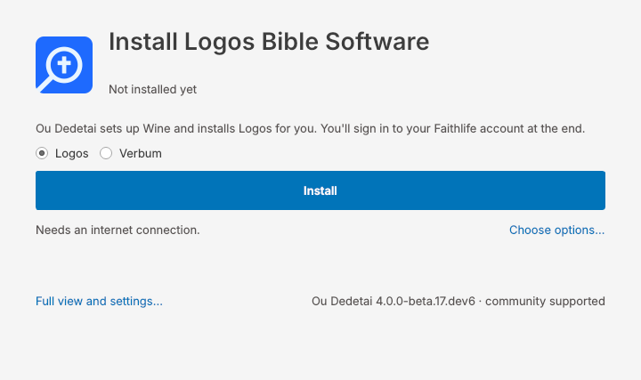

Choose Logos or Verbum and press **Install**. That's all most people need: Ou Dedetai picks
the recommended Wine build and settings. **Choose options…** lets you pick the product
version, release and Wine build yourself.

Before installing, Faithlife's licence agreement is shown in full, as their installer shows
it on Windows.

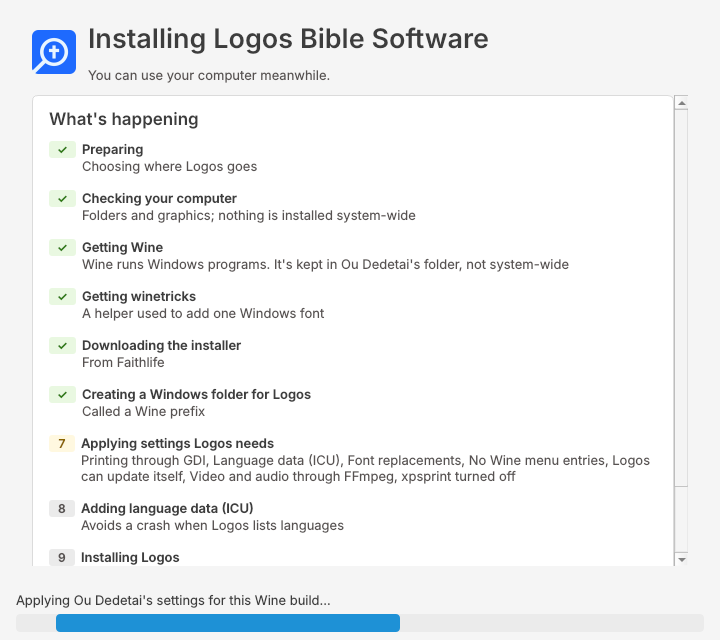

While it installs, the window lists each step in plain words. You can use your computer
meanwhile. When it's done, press **Run Logos**. The first time, Logos asks you to sign in to
your Faithlife account: the sign-in page opens in your browser and returns you to Logos.

## Everyday use: the simple view

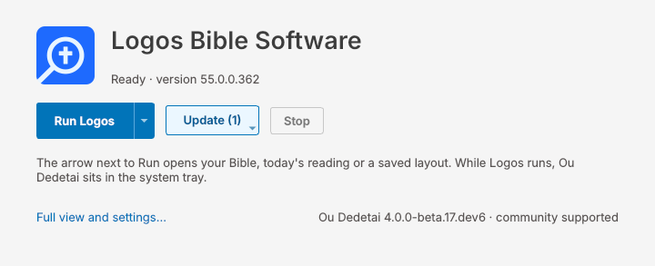

- **Run Logos** starts Logos. The arrow next to it opens your preferred Bible, today's reading
  or a saved layout straight away.
- **Update** shows a count when something can be updated (Ou Dedetai, Wine, Logos,
  Akousousin or the desktop integrations) and lists them.
- **Stop** asks Logos to close, as its own close button does (see [Stopping Logos](#stopping-logos)).

The Logos shortcut in your app menu does the same as Run. While Logos runs, Ou Dedetai sits in
the system tray:

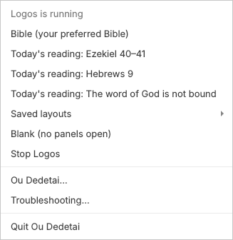

Right-clicking the Logos shortcut in your app menu also offers Today's reading, Stop and Ou
Dedetai itself.

## The full view

**Full view and settings…** opens the full view. To open it every time, tick the option under
Settings → Ou Dedetai window.

### Home

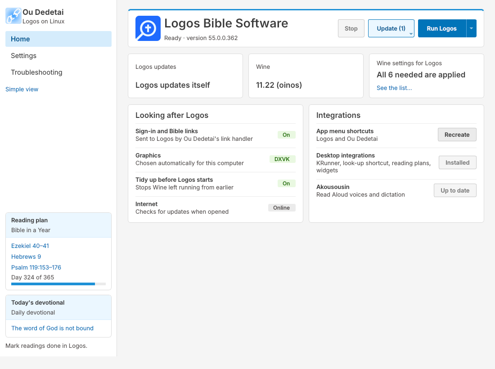

Home shows what Ou Dedetai is doing for Logos: which Wine build it uses, whether all the Wine
settings Logos needs are applied, the graphics renderer chosen for your computer, the app menu
shortcuts and the optional integrations. With the desktop integrations installed, your
reading plan and today's devotional appear on the left; click a reading to open it in Logos.

While Logos runs, anything that would change Logos's files or Wine settings is greyed out
("Close Logos first"):

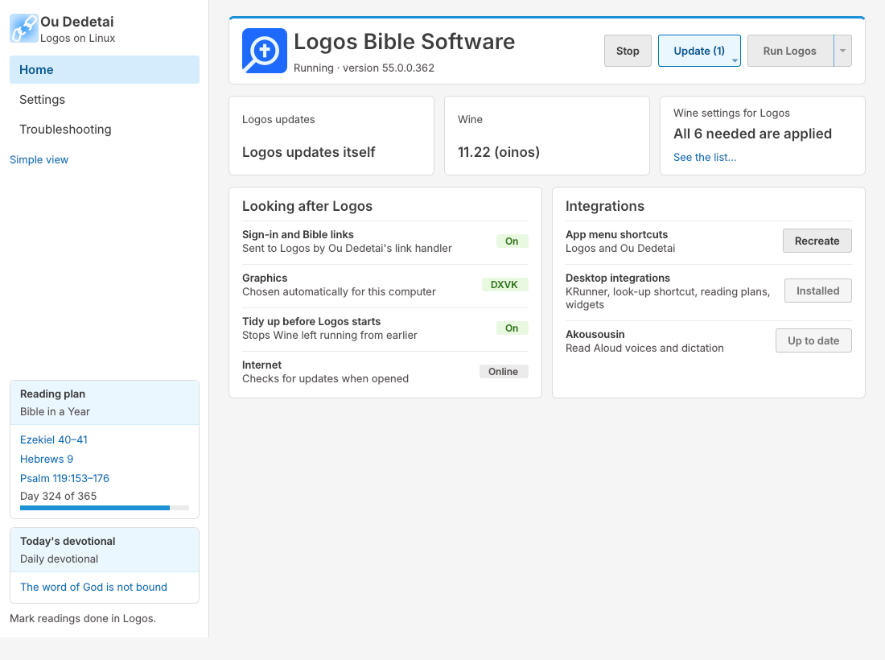

### Settings

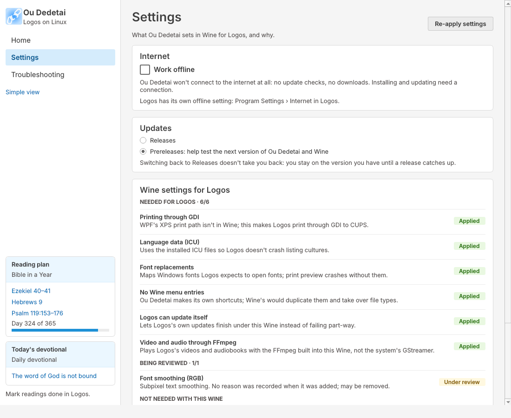

- **Work offline**: Ou Dedetai won't connect to the internet at all (no update checks, no
  downloads) until you switch it off. Installing and updating need a connection. Logos has its
  own offline setting under Program Settings › Internet.
- **Updates**: Releases, or Prereleases to help test the next version of Ou Dedetai and of our
  Wine build. Switching back to Releases doesn't take you back to an older version: you stay on
  the one you have until a release catches up.
- **Wine settings for Logos**: every setting Ou Dedetai applies in Wine, why Logos needs it,
  and whether it's applied in your install. **Re-apply settings** puts them back if something
  changed them.
- **Show developer and testing options** reveals tools most people never need:

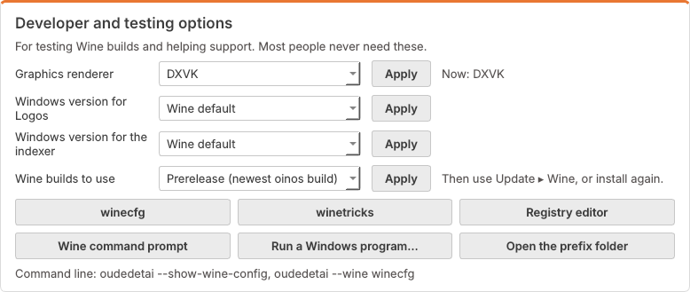

### Troubleshooting

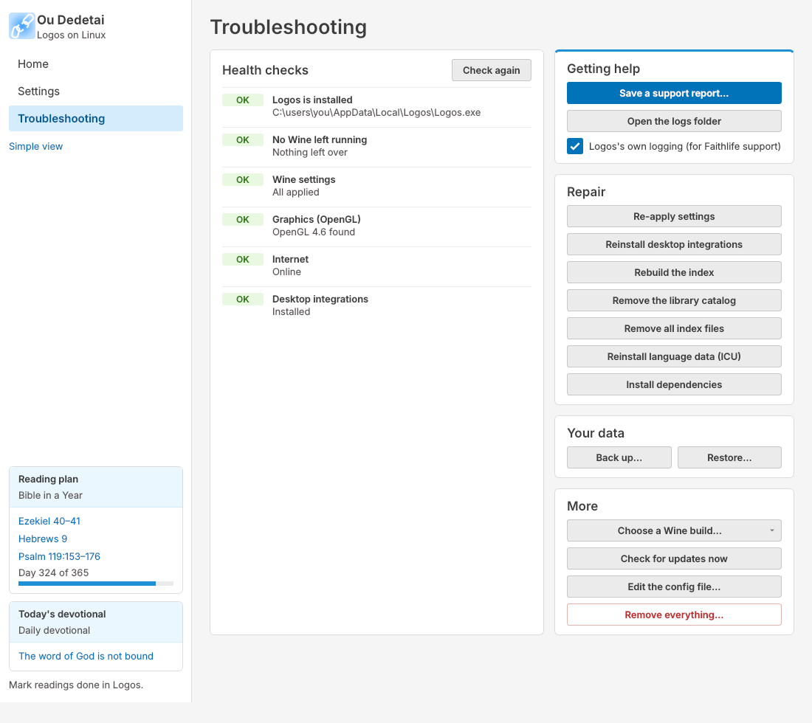

- **Health checks** look for common problems; a leftover Wine process can be ended from here.
- **Save a support report…** collects Ou Dedetai's logs and system details into one file to
  attach when asking for help. **Logos's own logging** turns on Logos's log for Faithlife's
  support (it can list the books you own, so it isn't added to the report).
- **Repair**: re-apply the Wine settings, reinstall the desktop integrations (after an OS
  update broke them), rebuild the index, remove the library catalog or index files, reinstall
  the language data, or install system dependencies.
- **Your data**: back up and restore Logos's data.
- **More**: choose another Wine build (our newest release or prerelease, or an AppImage or
  tarball from your computer), check for updates now, edit the config file, or **Remove
  everything** Ou Dedetai installed.

## Stopping Logos

Stop asks Logos to close and waits while it finishes syncing or saving:

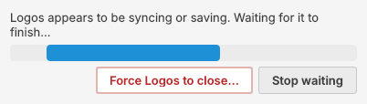

If Logos doesn't close, it may be asking you something (unsaved work, for example): check its
window. If its window has already gone, Logos is stuck shutting down and forcing it is safe:

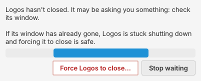

**Force Logos to close…** ends Logos and every Wine process it left behind. Changes that
haven't synced to your Faithlife account yet may be lost.

## Optional extras

- **Akousousin** gives Logos's Read Aloud natural voices and adds dictation. Ou Dedetai installs
  it with Logos and updates it from the Update menu. Open Akousousin to choose or download a
  voice.
- **Logos desktop integrations** (KDE Plasma and GNOME) add Logos to KRunner or the Activities
  search, a shortcut to look up a copied Bible reference, reading-plan reminders, and on
  Plasma, desktop widgets. Ou Dedetai offers them once; install them later from Home.

## Command line

Everything in the window is also available from the command line, which is handy for
support and remote installs. A few common ones:

| Command | What it does |
|---|---|
| `oudedetai --install-app` | Install Logos (add `-y` to accept the defaults) |
| `oudedetai --run-installed-app` / `--stop-installed-app` | Start Logos / close it politely |
| `oudedetai --update-self` | Update Ou Dedetai |
| `oudedetai --set-update-channel prereleases` | Follow test builds (`releases` to go back) |
| `oudedetai --set-runner FILE` | Use a Wine AppImage or tarball from your computer |
| `oudedetai --show-wine-config` | List the Wine settings Ou Dedetai applies and their state |
| `oudedetai --set-offline on` | Work offline (`--offline` for just one run) |
| `oudedetai --get-support` | Save a support report |
| `oudedetai --purge` | Remove everything Ou Dedetai installed |
| `oudedetai --wine winecfg` | Run a Windows program in Logos's Wine prefix |

`oudedetai --help` lists them all.

## Languages

The window is available in the languages Logos itself offers: English, Spanish, French,
German, Portuguese, Korean, and Simplified and Traditional Chinese. It follows your desktop's
language. Messages from the install steps, the terminal menu and the command line are in
English. The translations were made with AI help: corrections from native speakers are very
welcome (see [CONTRIBUTING.md](../CONTRIBUTING.md#translating-the-window)).
