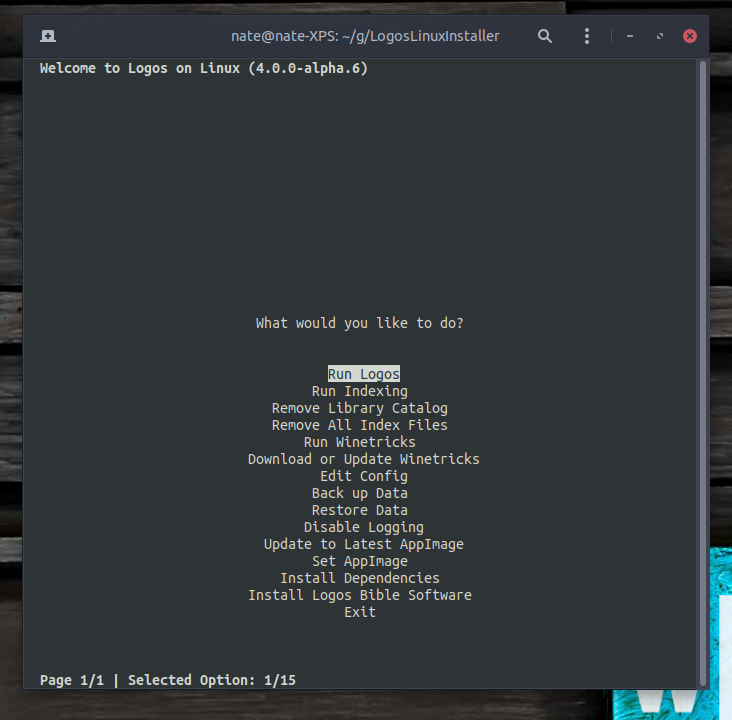

# Manual testing results

## Optarg testing

| Optargs | latest version tested | result | notes
| :--- | :--- | :---: | :--- |
| `-v/--version` | `main-20240426-09cb40d` | :+1: |
| `-F/--skip-fonts` | `4.0.0-alpha.6` | :+1: |
| `-a/--check-for-updates` | | |
| `-K/--skip-dependencies` | `4.0.0-alpha.6` | :+1: |
| `-V/--verbose` | `main-20240426-09cb40d` | :+1: |
| `-D/--debug` | `main-20240426-09cb40d` | :+1: |
| `-c/--config` | | |
| `-f/--force-root` | | |
| `-p/--custom-binary-path` | | |
| `-L/--delete-log` | `4.0.0-alpha.6` | :+1: |
| `--install-app` | `4.0.0-alpha.6` | :+1: |
| `--run-installed-app` | `4.0.0-alpha.6` | :+1: |
| `--run-indexing` | | |
| `--remove-library-catalog` | | |
| `--remove-index-files` | | |
| `--edit-config` | `main-20240426-09cb40d` | :-1: | gnome-text-editor symbol lookup error: /lib/x86_64-linux-gnu/libcairo.so.2: undefined symbol: FT_Get_Transform
| `--install-dependencies` | `main-20240426-09cb40d` | :+1: |
| `--backup` | | |
| `--restore` | | |
| `--update-self` | | |
| `--update-latest-appimage` | | |
| `--set-appimage` | | |
| `--get-winetricks` | | |
| `--run-winetricks` | `4.0.0-alpha.6` | :+1: |
| `--toggle-app-logging` | `4.0.0-alpha.6` | :+1: |
| `--create-shortcuts` | | |
| `--remove-install-dir` | `4.0.0-alpha.6` | :+1: |
| `--dirlink` | | |
| `--check-resources` | | |

## TUI testing

| Option | latest version tested | result |
| :--- | :--- | :---: |
| Install [app] | `4.0.0-alpha.6` | :+1: |
| Run app | `4.0.0-alpha.6` | :+1: |
| Run indexing |||
| Remove all index files |||
| Run Winetricks | `4.0.0-alpha.6` | :+1: |
| Download/Update Winetricks |||
| Edit Config | `4.0.0-alpha.6` | :+1: |
| Back up Data |||
| Restore Data |||
| Enable/Disable [app logging] |||
| Update to Latest AppImage |||
| Set AppImage |||
| Install Dependencies |||

## GUI testing

| Button/Action | latest version tested | result |
| :--- | :--- | :---: |
| Install [app] | `4.0.0-alpha.6` | :+1: |
| Run app | `4.0.0-alpha.6` | :+1: |
| Run indexing |||
| Remove library catalog |||
| Remove all index files |||
| Edit... [config file] | `main-20240426-09cb40d` | :-1: | Ubuntu 24.04: gnome-text-editor symbol lookup error: /lib/x86_64-linux-gnu/libcairo.so.2: undefined symbol: FT_Get_Transform
| Install [dependencies] | `main-20240426-09cb40d` | :-1: | Ubuntu 24.04: fails to prompt for password
| Backup |||
| Restore |||
| [Self-]Update |||
| Run [Update to Latest AppImage] |||
| Run [Set AppImage] |||
| Run [Winetricks] | `4.0.0-alpha.6` | :+1: |
| Download/Update [Winetricks] |||
| Enable/Disable [app logging] |||
## Wine runtime selection

Use an existing test installation with Logos and its indexer stopped. Switching
Wine does not roll back changes a Wine build subsequently makes to the prefix.

1. GUI: open **Wine runtime → Select…**. TUI: choose **Select Wine runtime…**.
   CLI: run `oudedetai --select-wine`. Check that the current executable is shown.
2. Choose an AppImage in Downloads without execute permission. Confirm that the
   managed copy becomes executable, the original is unchanged, and launching
   Logos uses the selected version. Restart Ou Dedetai and check the selection.
3. Select another installed AppImage, then switch back. Check `wine --version`
   via `oudedetai --wine --version` and launch Logos with each selection.
4. Select system Wine, local Proton, and a custom Wine executable in turn. For
   an uninstalled Wine build, check detection of `server/wineserver`, or select
   its matching server explicitly when prompted. Check the selected runtime in
   the Wine log and test launching Logos and the indexer.
5. Leave the runtime menu with Esc and cancel a file dialog. Try an invalid AppImage or an executable
   that fails `--version`. Confirm the prior selection remains active.
6. Start Logos or indexing, then attempt a switch. Confirm the manager asks you
   to stop them without changing the selection.
7. From an AppImage installation, test **Update to Latest AppImage** when an
   update exists. Confirm it activates and persists the downloaded runtime.

### Combined runtime picker

- In the GUI, verify one resizable list contains installed AppImages, local Wine,
  local Proton (including build names), and the current custom build. The current
  runtime starts highlighted. The recommended AppImage has `(recommended)`;
  `(current)` is independent and may appear on another entry. The recommendation
  follows the installer default for this machine, including its beta-channel
  workaround for Chromium and Snap/Flatpak browsers, and stable fallback when
  no beta AppImage is available.
- Check local Wine and Proton with and without installations. Missing entries
  must say `(not found)`, appear grey, and cannot enable **Select**. Detected
  entries gain their reported Wine version without freezing the window; a failed
  or timed-out probe says `version unknown`.
- Check long filenames and paths with the horizontal and vertical scrollbars,
  resize the window, and copy the selected path from the read-only path field.
- Use **Add new…** for an AppImage in Downloads and for a personal Wine build.
  Choosing the candidate should validate and activate it immediately. Ask for wineserver only when it cannot be found.
- Try a failed activation or decline a version warning: the window stays open,
  the old runtime stays active, and another choice can be selected.
- In TUI/CLI, verify the combined menu includes versions, current/recommended
  labels, and **Add new…**. Missing runtimes appear as informational text rather
  than selectable choices. Choosing a file activates it immediately.

- Check that the instruction is bold and the window background matches the
  themed label/frame backgrounds, including the gaps around the buttons.
- While the newest `FaithLife-Community/wine-appimages` release is marked as a
  pre-release, confirm both the latest stable AppImage and the pre-release are
  listed, the pre-release labelled **(pre-release)** and the stable release
  **(recommended)**. This holds with a Chromium, snap or Flatpak default browser
  too: #435 only logs a warning and no longer switches the install to the
  pre-release. After the pre-release is promoted, only the new stable release
  should be offered.
- With the recommended AppImage absent, confirm it still appears as
  **(recommended) (download required)** and can be selected. Opening or cancelling
  the picker must not download anything. **Select** should reuse the installer's
  download/cache/verification flow, show progress, then activate the managed copy.
  Repeat with a cached download and a failed download: failure must leave the
  picker open and preserve the active runtime and configuration.

### Runtime file browsing and cancellation

- Open **Add new…** in GUI and TUI: start in `$HOME/Downloads`, or `$HOME` if
  Downloads does not exist. Show AppImage files initially and keep directories
  navigable. Switch to **All files** to choose a custom Wine executable.
- In TUI, use the existing themed list and buttons: arrows to move, Enter to
  open a directory or choose a file, `.. /` to move up, and the optional path
  field to paste a location. Check filenames containing spaces and brackets.
- Cancel or Esc in the file browser returns to the runtime menu without adding
  or activating anything. In the runtime menu, the **Cancel** button or Esc leaves
  without changing Wine; there are no extra Cancel/Exit entries in the list. Check
  a long list in an 80×16 terminal: the Cancel button must stay visible.
- Other TUI prompts are unchanged: they still offer **Exit** and **Return to Main
  Menu** where they did before.
- Select a custom Wine build without a discoverable wineserver. The TUI server
  chooser should browse all files, starting beside that Wine executable.

### Final runtime selection flow

- The current runtime is always first, bold, and marked `(current)` in GUI and
  TUI. Selecting it returns without writing configuration or changing links.
  **Cancel**, Esc or closing the window leaves it without changes.
- **Add new…** opens the filtered file chooser. Choosing a file validates and
  activates it immediately, then returns to the main window/menu. There is no
  second Select step. Cancel in the file chooser returns to the runtime list.
- Invalid files, failed downloads/saves, or declined compatibility warnings
  leave the runtime list open and preserve the previous selection.

### Optional runtime selection before installing

- With no Logos/Verbum installation, verify the normal **Install** action still
  uses its existing default runtime with no additional runtime question.
- Before installing, open **Wine runtime → Select…** in GUI, **Select Wine
  runtime…** in TUI, or `oudedetai --select-wine` in CLI. The GUI advanced-install
  dialog also has **Choose runtime…**. Choose an AppImage, local Wine, Proton, or
  personal Wine build. Cancel/Esc leaves the normal default-install path available.
- Choosing before installing only records the choice. Confirm nothing is
  downloaded, copied or linked, and you are not asked for a product or install
  directory; the installer then asks its usual questions (minus the Wine one).
  A pre-release or stable release is downloaded by the installer, not the picker.
- Run the installation after selecting a runtime. Check prefix initialization,
  MSI execution, and wineserver commands all use the selection. An explicit
  AppImage must not be replaced by the default download, and a personal build's
  separately chosen wineserver must be retained. Restart and confirm persistence.
- Remove a selected runtime before installing: installation should report it
  missing rather than silently choosing a default.
- While a runtime dialog is open, attempting to install must ask you to finish
  the selection. During installation another GUI picker must not switch runtimes.
